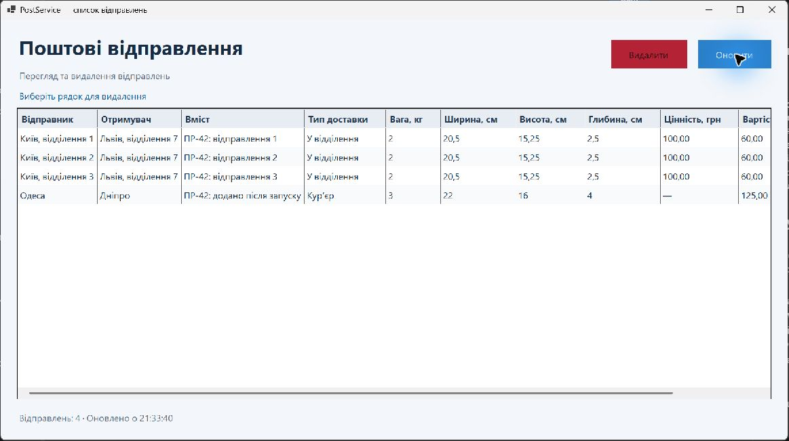

# ПР-42 Клієнт-серверна взаємодія у Windows Forms

Клієнт `PostService.App` відкриває список поштових відправлень із локального API, оновлює таблицю за кнопкою «Оновити» та видаляє вибране відправлення після підтвердження. Сервер зберігає дані в SQLite. Обидва проєкти використовують спільний контракт `PostService.Dtos`.

[Звіт Word](reports/PR-42-report.docx) · [Журнал збірки](reports/build-results.txt) · [Перевірки API](reports/api-checks.txt)

## Збірка і запуск

Потрібні Windows та .NET SDK 10. Команди виконуються з кореня репозиторію.

```powershell
cd PostServiceSolution
dotnet build PostService.slnx -warnaserror
dotnet run --project PostService/PostService.csproj --no-build
```

Коли сервер запуститься на `http://localhost:5211`, відкрийте другий PowerShell у папці `PostServiceSolution` і запустіть клієнт.

```powershell
dotnet run --project PostService.App/PostService.App.csproj --no-build
```

У Visual Studio з підтримкою .NET 10 і компонентом `.NET desktop development` відкрийте `PostService.slnx`. Поруч є спільний профіль `PostService.slnLaunch`. Оберіть **PostService — Server and Client** для запуску обох проєктів за F5. Збірку та запуск у цій роботі перевірено через .NET CLI.

## Демонстрація

1. Створіть записи запитами POST із `PostServiceSolution/http-requests.rest` і відкрийте клієнт.
2. Створіть ще один запис. Натисніть «Оновити» й перевірте появу нового рядка.
3. Виберіть тестовий рядок, натисніть «Видалити» та підтвердьте дію.
4. Виконайте `GET /postings`. Відповідь і таблиця мають показати список без видаленого відправлення.

У вікні перевірено початкове завантаження трьох записів, появу четвертого після оновлення, вибір рядка й відкриття підтвердження. Остаточне видалення перевірено окремо запитом `DELETE` у тимчасовій тестовій базі. Сервер повернув `204`, після перезапуску `GET` і повторний `DELETE` для видаленого запису повернули `404`.


