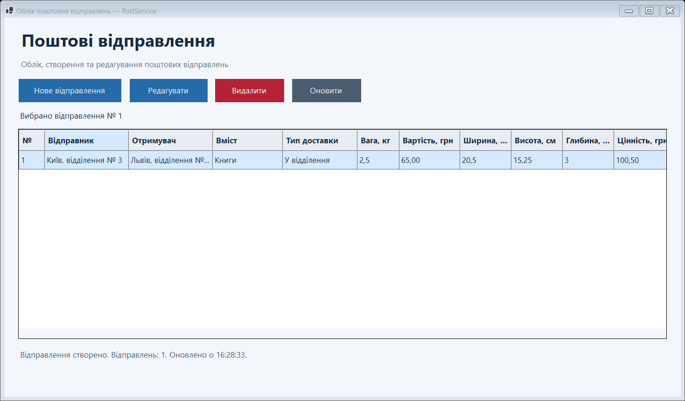
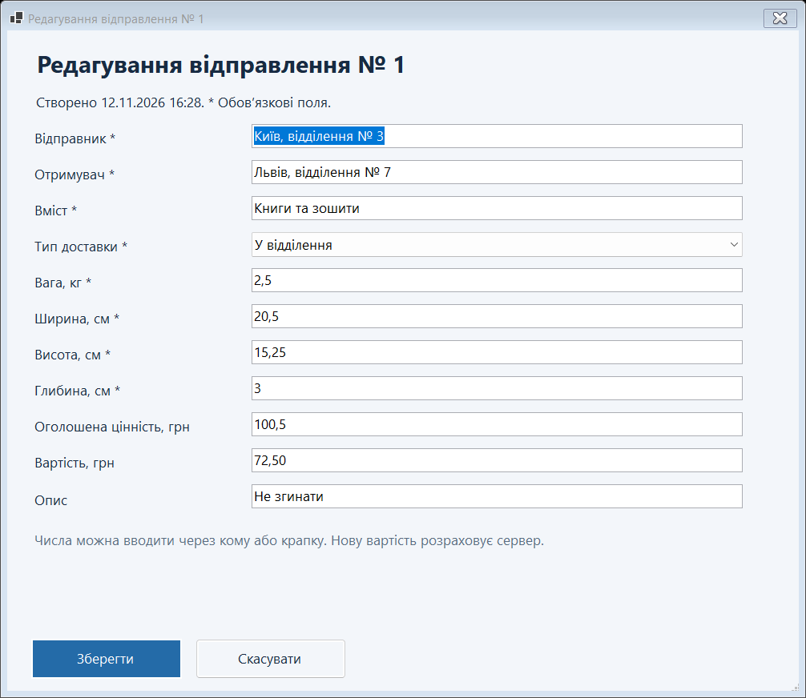
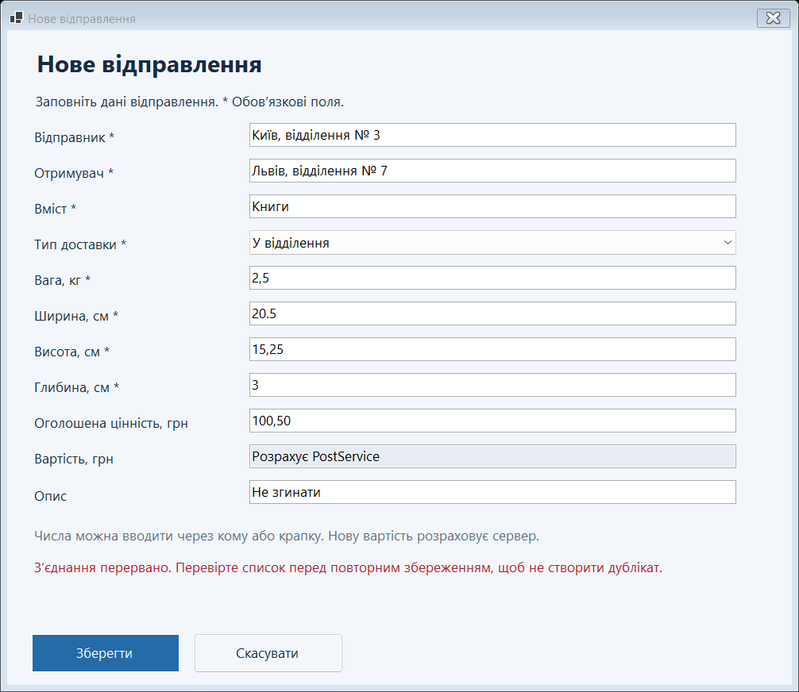

# Windows Forms — Облік поштових відправлень

Завершений настільний клієнт PostService з **двома формами**: головним списком `PostingList` і спільним модальним діалогом `PostingEditor` для створення та редагування. Реалізовано отримання списку, створення, редагування, скасування та видалення через наявний REST API.

**Матеріали цієї практичної:**

- [Звіт Word на 5 сторінок](submission/WinForms-report.docx)
- [Скрипт підготовки готового комплекту Windows x64](scripts/Publish-Windows.ps1) — створює ZIP із сервером, клієнтом і runtime .NET.
- [Скриншоти та перевірки](submission/)
- [Адаптація макетів ПР-44](design/ADAPTATION.md)

Ця гілка містить нову практичну. Попередня реалізація ПР-42 збережена в `main`; каталог `reports/` є матеріалами попереднього етапу. Актуальний звіт і перевірки розміщено в `submission/`.

## Запуск готового застосунку

1. Готовий ZIP передається окремим файлом. Або створіть його з вихідного коду командою `./scripts/Publish-Windows.ps1` за наявності .NET SDK 10. Розпакуйте весь архів у доступну для запису папку.
2. Запустіть `Start.cmd`. Відкриються сервер і настільний клієнт.
3. Альтернативний ручний запуск: спочатку `Server/PostService.exe`, потім `Client/PostService.App.exe`.
4. Для сервера використовується `http://localhost:5211`. Якщо сервер ще запускається, натисніть у клієнті «Оновити».
5. Після роботи закрийте клієнт і консоль сервера. SQLite зберігає записи між запусками.

Архів призначений для Windows x64 і містить .NET runtime для обох програм. База створюється автоматично; чужих чи попередньо заповнених баз в архіві немає.

## Збірка з вихідного коду

Потрібні Windows та .NET SDK 10. Команди виконуються з кореня репозиторію.

```powershell
dotnet build PostServiceSolution/PostService.slnx -warnaserror
dotnet run --project PostServiceSolution/PostService/PostService.csproj --no-build
```

В іншому PowerShell:

```powershell
dotnet run --project PostServiceSolution/PostService.App/PostService.App.csproj --no-build
```

У Visual Studio з компонентом `.NET desktop development` відкрийте `PostServiceSolution/PostService.slnx`. Сервер і клієнт також можна запускати через наявний спільний профіль `PostService.slnLaunch`.

Іншу адресу API можна задати змінною середовища `POST_SERVICE_URL` перед запуском клієнта. За замовчуванням використовується `http://localhost:5211/`.

## Реалізовані можливості

- При запуску відкривається список. Кнопки редагування й видалення доступні після вибору рядка. Подвійне натискання на рядок відкриває редагування.
- Створення та редагування використовують один `PostingEditor`, який відкривається через `ShowDialog`. При редагуванні виконується свіжий `GET /postings/{id}`.
- Після `POST`, `PUT` та `DELETE` список повторно завантажується із сервера. Після збереження вибирається відповідний рядок.
- «Скасувати», Escape або закриття діалогу не зберігають введених змін.
- Відправник, отримувач і вміст обов’язкові. Вага — більше нуля й до 1 000 000 кг включно; габарити — додатні; цінність і ціна під час редагування — невід’ємні. Порожні цінність та опис передаються як `null`.
- Числа приймають кому або крапку; `NaN`, нескінченність та переповнення відхиляються. Тип доставки обирається з трьох дозволених значень.
- Ціну нового запису розраховує сервер. У режимі редагування можна змінити наявну ціну. `Id` і дата створення залишаються серверними даними.
- Помилки показуються через `ErrorProvider`, текст у діалозі та повідомлення про невдалі операції. Після помилки збереження введені поля залишаються заповненими.
- Поки збереження виконується, кнопки заблоковані. У разі втрати відповіді клієнт просить перевірити список перед повторним збереженням.
- Перед видаленням показуються номер і напрямок відправлення; за замовчуванням вибрано скасування.

## Демонстрація

1. Натисніть «Нове відправлення», спробуйте зберегти порожню форму — з’являться повідомлення про помилки.
2. Введіть: відправник `Київ, відділення № 3`, отримувач `Львів, відділення № 7`, вміст `Книги`, доставка `У відділення`, вага `2,5`, габарити `20,5 × 15,25 × 3`, цінність `100,50`.
3. Збережіть. Сервер поверне новий запис із вартістю `65,00`; список оновиться автоматично.
4. Виберіть його, натисніть «Редагувати», змініть вміст на `Книги та зошити`, вартість на `72,50` і збережіть.
5. Повторно відкрийте редагування, змініть поле та натисніть «Скасувати». У списку залишаться попередні збережені дані.
6. Для тестового запису натисніть «Видалити». Перевірте скасування, потім повторіть дію та підтвердьте видалення. Рядок зникне після відповіді сервера.

## Перевірки

Збірка завершилася з **0 помилок і 0 попереджень**. Пройшли **34 перевірки** правил введення й REST клієнта та **15 перевірок** справжніх класів Windows Forms у потоці STA.

- [Журнал збірки](submission/build-results.txt)
- [Перевірки валідації та REST API](submission/api-checks.txt)
- [Перевірки форм](submission/ui-checks.txt)
- [Перевірка готового комплекту](submission/package-checks.txt)

Перевірки форм тестують створення, автоматичне оновлення, заповнення режиму редагування, PUT, обидва сценарії скасування, порожній список і збереження введених даних за недоступного сервера. Знімки PNG формуються із цих форм під час тесту; додаткові JPG показують ручну перевірку вікон. Це знімки реалізації, а не макети ПР-44.

Відтворення автоматичних перевірок — **лише з окремою порожньою тестовою базою**. Запустіть сервер в окремому PowerShell:

```powershell
New-Item -ItemType Directory -Force .test-data | Out-Null
dotnet run --project PostServiceSolution/PostService/PostService.csproj --no-build -- --urls http://localhost:5317 --contentRoot "$PWD/.test-data"
```

В іншому PowerShell:

```powershell
dotnet run --project Checks/Checks.csproj -- http://localhost:5317/
dotnet run --project UiChecks/UiChecks.csproj -- http://localhost:5317/ .test-screens
```

## Приклади роботи






